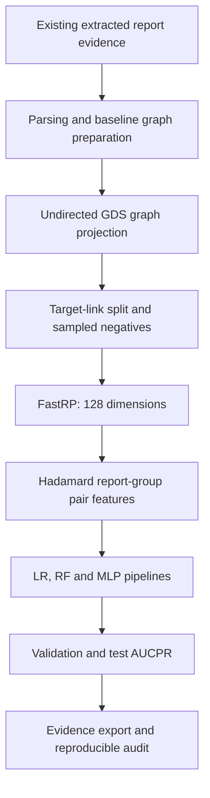

# Reconstruction of APT Scope

**Iqra Ilyas · MS Cybersecurity · FAST NUCES Islamabad**  
Applied Information Security · Reports-only Scenario 1 reconstruction · Evidence dated 18 November 2026

This repository documents an **approximate reconstruction** of APT-Scope's reports-only graph link-prediction experiment. It preserves the observed Neo4j GDS results, provides an executable evidence audit, and compares them with the paper's Scenario 1.

**Status:** three native GDS models completed in the original Windows environment. Offline evidence checks pass. The newly packaged replay runner has been plan-checked and unit-tested, but has **not** been run against Neo4j in this packaging environment. The original database, complete preprocessing scripts and raw dataset are not included, so this is not a one-command reproduction from raw reports.

## Start here: reviewer guide

1. Read the [primary analysis and comparison](analysis/RESULTS.md).
2. Inspect the [preserved evidence](evidence/original/) and [full reconstruction audit](docs/RECONSTRUCTION_AUDIT.md).
3. Run `python src/audit_results.py` to verify the exported numbers without Neo4j.
4. Review [methodology and configuration](docs/METHODOLOGY.md), [reproduction instructions](docs/REPRODUCING.md), and [limitations](docs/LIMITATIONS.md).

A short [reviewer checklist](docs/REVIEWER_GUIDE.md) identifies the evidence for each claim.

## Research objective

Reconstruct the graph-based association of a threat report with an APT group using FastRP embeddings and conventional classifiers. The target is a candidate `BaselineReport -[HAS_APT_GROUP]-> BaselineGroup` relationship. It is transductive relationship prediction, not classification of entirely unseen reports.

## Observed results

| Model | Mean validation AUCPR | Test AUCPR | Training duration |
|---|---:|---:|---:|
| Logistic regression | 0.767759 | 0.796090 | 1.695 s |
| Random forest | 0.721579 | 0.678773 | 16.509 s |
| Multilayer perceptron | **0.771336** | 0.795566 | 14.339 s |

MLP has the highest mean validation score. LR's test advantage over MLP is only 0.000524. These scores are **GDS AUCPR, not accuracy**. Durations refer to training calls reported in saved summaries, not the complete workflow.

| Model | Paper Scenario 1 test AUCPR | Reconstruction test AUCPR | Descriptive difference |
|---|---:|---:|---:|
| Logistic regression | 0.6971 | 0.796090 | +0.098990 |
| Random forest | 0.5395 | 0.678773 | +0.139273 |
| MLP | 0.6943 | 0.795566 | +0.101266 |

**These differences do not demonstrate an improved method.** Report coverage, features and some settings differ from the paper. Scenario 2's enriched results are outside this reconstruction's scope. See the [comparison interpretation](analysis/RESULTS.md).

## Implementation overview



### Data and graph coverage

| Item | Count | Evidence level |
|---|---:|---|
| Reports | 743 | Original session checks; row manifest not bundled |
| Reports with group associations | 488 | Original session checks |
| Reports without group associations | 255 | Original session checks |
| Raw group names | 564 | Includes aliases; not 564 independently verified actors |
| Indicator nodes | 57,535 | Original session checks |
| Report–indicator relationships | 68,795 | Original session checks |
| Report–group relationships | 1,121 | Original session checks |
| Alias-context relationships | 479 | Original session checks; provenance review needed |
| Total projected nodes | **58,842** | Exported graph metadata |
| Projected relationships | **140,790** | Exported graph metadata, including both directions |

The undirected projected relationship count corresponds to 70,395 stored relationships counted in the session. It must not be presented as 140,790 distinct source facts.

## Quick verification (no database required)

Python 3.10 or newer is sufficient for the audit and tests. No third-party package is required for these commands.

```powershell
 git clone https://github.com/Iqra2030/Reconstruction-of-APT-Scope.git
 cd Reconstruction-of-APT-Scope
 python src/audit_results.py
 python -m unittest discover -s tests -v
```

Expected audit outcome: checksum verification, agreement between three result summaries and catalogue metrics, graph-total verification, and candidate/feature consistency checks. `analysis/comparison.csv` and `analysis/RESULTS.md` are regenerated.

## Code and evidence provenance

| Path | Role | Status |
|---|---|---|
| `evidence/original/` | Original 13 exported files, byte-preserved | Original run evidence |
| `evidence/original/export_paper_s1_evidence.py` | Script used to export evidence | Original script; Windows path retained |
| `src/audit_results.py` | Verifies evidence and generates comparison | New packaging utility, locally executed |
| `src/replay_training.py` | Reconstructs native GDS training calls from metadata | New utility; live execution not validated here |
| `src/export_graph_snapshot.py` | Read-only export of existing Baseline graph | New utility; live execution not validated here |
| `tests/` | Integrity and replay-plan checks | Four tests pass locally |
| `docs/` | Methods, audit, limitations and reviewer instructions | Derived documentation |
| `diagrams/` | Proposed STIX extension methodology | Planned future work, not completed baseline |

## What is not included

The complete original preprocessing/import scripts, raw PDFs/IOC files, report manifest, database snapshot, trained model binaries, exact train/test pair memberships and prediction-level scores are unavailable in the supplied evidence. A model catalogue export cannot restore a trained model. The repository therefore separates **verification of saved results** from **rerunning training on an existing database**.

## Relationship to the proposed extension

The future study will test entity-only versus entity-plus-STIX-relationship features for report-level classification under campaign-aware evaluation. Its metric is macro F1. It has not been evaluated here, and its scores must not be compared directly with this link-prediction AUCPR. See [future work](docs/FUTURE_WORK.md).

## Attribution

B. Gulbay and M. Demirci, “APT-scope: A novel framework to predict advanced persistent threat groups from enriched heterogeneous information network of cyber threat intelligence,” *Engineering Science and Technology, an International Journal*, vol. 57, 101791, 2024. https://doi.org/10.1016/j.jestch.2024.101791

Repository used during the original session: https://github.com/Iqra2030/apt-scope. The historical source commit was not captured in the supplied archive. This reconstruction does not claim authorship of APT-Scope or redistribute its report corpus. Third-party data/code retain their original terms.
